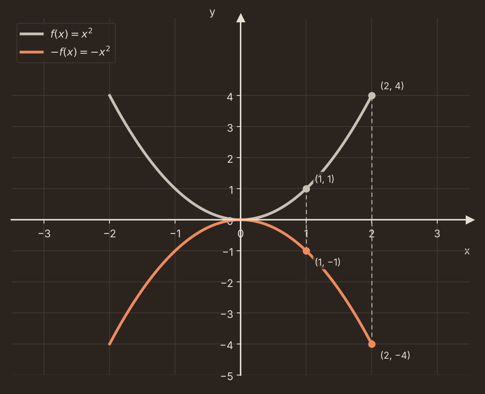
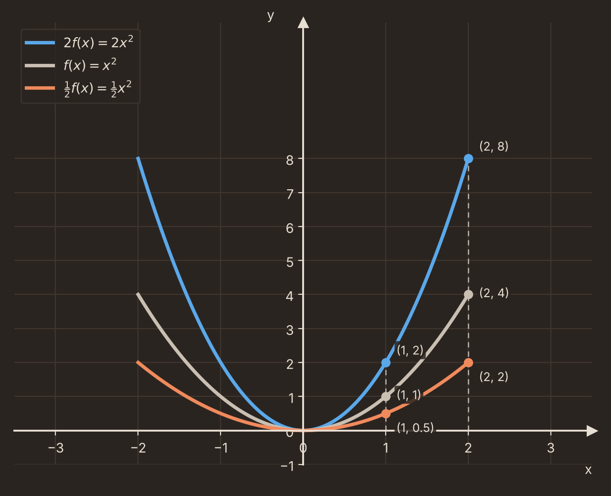
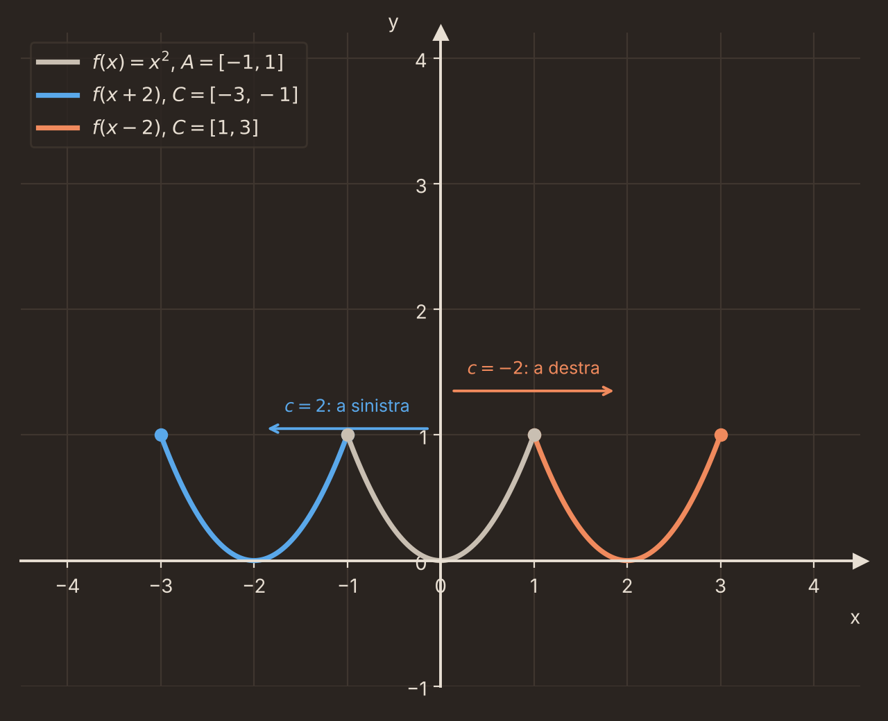

Data: 2026-10-13
[Analisi_1](./README.md)
#Puzzle_Of_Knowledge/Math/Analisi_1
___
# Index

- [[#Definizione Insiemistica]]
- [[#Definizione Operativa]]
	- [[#Notazione]]
	- [[#Insieme Immagine]]
	- [[#Controimmagine]]
- [[#Suriettività e Iniettività e Biettività]]
	- [[#Suriettiva]]
	- [[#Iniettiva]]
	- [[#Biiettiva]]
		- [[#Insiemi Numerabili]]
			- [[#Albergo Di Hilbert]]
- [[#Operazioni Tra Funzioni (Applicazioni)]]
	- [[#Somma]]
	- [[#Prodotto]]
	- [[#Rapporto (Quoziente)]]
- [[#Grafico Di Una Funzione e Traslazioni]]
	- [[#Traslazione Verticale: $f + c$|Traslazione Verticale: f + c]]
	- [[#Riflessione: $-f$|Riflessione: −f]]
	- [[#Dilatazione Verticale: $b f$|Dilatazione Verticale: b f]]
	- [[#Traslazione Orizzontale: $f(x + c)$|Traslazione Orizzontale: f(x + c)]]
- [[#Composizione Di Applicazioni]]
	- [[#Applicazione Identità]]
		- [[#Composizione a Destra]]
		- [[#Composizione a Sinistra]]
	- [[#Applicazione Inversa]]
___
# Definizione Insiemistica

> [!Abstract] Definizione: Insiemistica Di Applicazione
> Siano $A$, $B$ Insiemi.
> $$A \times B = {(a,b) : a \in A,\ b \in B}$$
> Diciamo **applicazione** un sottoinsieme $\Phi \subseteq A \times B$ tale che:
> $$\forall (a_1, b_1), (a_2, b_2) \in \Phi \text{ si ha che: se } a_1 = a_2 \implies b_1 = b_2$$
> 
>>[!info] Info: 
>>Perché sia un'applicazione da $A$ in $B$, ogni $a \in A$ deve comparire in qualche coppia di $\Phi$
>> 

> [!Info] Info: Esempi di Non Applicazioni
> Questi due esempi non sono applicazioni:

___

# Definizione Operativa

> [!Abstract] Definizione: Operativa Di Applicazione
> Siano $A, B$ insiemi.
> Diciamo **applicazione** una legge che associa ad ogni elemento di $A$ **un unico** elemento di $B$.
> > [!Info] Info:
> > 

## Notazione

> [!Abstract] Definizione: Notazione Di Applicazione
> 
$$\varphi : A \to B \qquad \text{"φ da A in B"}$$
> $$a \longmapsto \varphi(a) \in B \qquad \text{"a mappato in φ di a"}$$
> 
> - $A = D(\varphi)$ : **dominio** di $\varphi$
> - $B = C(\varphi)$ : **codominio** di $\varphi$
> 
>>[!Example] Esempio: 
>>
>>$$f: \mathbb{R} \to \mathbb{R},\quad x \mapsto x^2$$
>>$$g: \mathbb{R} \to [0,+\infty) = {x \in \mathbb{R} : x \ge 0},\quad x \mapsto x^2$$
>>$$h: [0,+\infty) \to [0,+\infty),\quad x \mapsto x^2$$
>>
>>
>>Sono tre applicazioni **diverse** (stessa legge, ma dominio/codominio diversi).
>>
>>|Applicazione|Dominio|Codominio|
> |---|---|---|
> |$f: \mathbb{R} \to \mathbb{R}$|$\mathbb{R}$|$\mathbb{R}$|
> |$g: \mathbb{R} \to [0,+\infty)$|$\mathbb{R}$|$[0,+\infty)$|
> |$h: [0,+\infty) \to [0,+\infty)$|$[0,+\infty)$|$[0,+\infty)$|
> >

## Insieme Immagine

> [!Abstract] Definizione: Insieme Immagine
> $$\mathrm{Im}(\varphi) := \left\{ b \in B \mid \exists a \in A \text{ per cui } \varphi(a) = b \right\} \subseteq B = C(\varphi)$$
> > [!Info] Info: 
> > - **Dominio** = tutto l’insieme $A$, cioè tutti i valori che si possono mettere in input.
> > - **Codominio** = tutto l’insieme $B$, cioè tutti i valori in cui si potrebbe arrivare.
> > - **Insieme immagine** = i valori di $B$ che vengono davvero raggiunti da qualche elemento di $A$
> > >   
> 
> > [!Example] Esempio: $f$ $g$ $h$
> > | Applicazione                     | Insieme immagine               |
> | -------------------------------- | ------------------------------ |
> | $f: \mathbb{R} \to \mathbb{R}$   | $\mathrm{Im}(f) = [0,+\infty)$ |
> | $g: \mathbb{R} \to [0,+\infty)$  | $\mathrm{Im}(g) = [0,+\infty)$ |
> | $h: [0,+\infty) \to [0,+\infty)$ | $\mathrm{Im}(h) = [0,+\infty)$ |
> 
> > [!Info] Info:
> > In generale $\mathrm{Im}(\varphi)$ è un sottoinsieme (anche proprio) del codominio $B$.
> > 
>
> > [!Abstract] Definizione: Altro Modo Per Rappresentare L'Insieme Immagine
> >$$\mathrm{Im}(\varphi) = \varphi(A)$$

## Controimmagine

> [!Abstract] Definizione: Controimmagine
> Sia $S \subseteq B$.
> Definiamo la **controimmagine** di $S$ secondo $\varphi$ l'insieme:
> $$\varphi^{-1}(S) := \left\{a \in A \mid \varphi(a) \in S \right\} \subseteq A$$
> 
> > [!Danger] Attenzione:
> > $\varphi^{-1}$ qui è un'operazione sui **sottoinsiemi** e non vuol dire "Funzione Inversa"
> 
> > [!Example] Esempio:
> > 
> 
> > [!Example] Esempio:
> > $f: \mathbb{R} \to \mathbb{R}$, $x \mapsto x^2$, $S = \left\{-1 \right\}$: $$f^\left\{-1\right\}(S) = \left\{x \in \mathbb{R} \mid x^2 = -1\right\} = \emptyset$$
> > $\ell: \mathbb{C} \to \mathbb{R}$, $x \mapsto x^2$, $S = \left\{-1\right\}$: $$\ell^{-1}(S) = \left\{x \in \mathbb{C} \mid x^2 = -1 \right\} = \left\{i, -i \right\}$$
> 
> > [!Info] Info: Controimmagine Lavora Sull'Insieme Delle Parti
> > Un’applicazione $\varphi: A \to B$ prende **un elemento** $a \in A$ e restituisce **un elemento** $\varphi(a) \in B$. 
> > La controimmagine invece prende **un insieme** $S \subseteq B$ e restituisce **un insieme** $\varphi^{-1}(S) \subseteq A$. 
> > Il suo input non è un elemento di $B$ ma un sottoinsieme di $B$, cioè un elemento di $\mathcal{P}(B)$. 
> > Il suo output è un sottoinsieme di $A$, cioè un elemento di $\mathcal{P}(A)$. Per questo si scrive $$\varphi^{-1}: \mathcal{P}(B) \to \mathcal{P}(A), \qquad S \longmapsto \varphi^{-1}(S)$$
> 
> > [!Info] Info:
> > $$\text{se } S \cap \varphi(A) = \emptyset \implies \varphi^{-1}(S) = \emptyset$$

___
# Suriettività e Iniettività e Biettività

## Suriettiva

> [!Abstract] Definizione: Suriettiva
>  $\varphi: A \to B$ si dice **suriettiva** se e solo se: $$\mathrm{Im}(\varphi) = B$$

## Iniettiva

> [!Abstract] Definizione: Iniettiva
>  $\varphi: A \to B$ è detta **iniettiva** se e solo se:
>  $$\forall a_1, a_2 \in A,\ a_1 \neq a_2 \text{ si ha che } \varphi(a_1) \neq \varphi(a_2)$$

> [!Example] Esempio: Suriettiva e Iniettiva
> 

> [!example] Esempio: $f$, $g$, $h$ — suriettiva e iniettiva
>
> $$f: \mathbb{R} \to \mathbb{R}, \qquad x \mapsto x^2$$
> - **Non è suriettiva**: $\mathrm{Im}(f) = [0,+\infty) \ne \mathbb{R}$
> - **Non è iniettiva**: $1^2 = 1 = (-1)^2$, ma $1 \ne -1$
>___
> $$g: \mathbb{R} \to [0,+\infty), \qquad x \mapsto x^2$$
> - **È suriettiva**: $\mathrm{Im}(g) = [0,+\infty)$
> - **Non è iniettiva**: $\forall \alpha > 0, g^{-1}(\{\alpha\}) = \{-\sqrt{\alpha},\ \sqrt{\alpha}\}$ ha due elementi
>___
> $$h: [0,+\infty) \to [0,+\infty), \qquad x \mapsto x^2$$
> - **È suriettiva**: $\mathrm{Im}(h) = [0,+\infty)$
> - **È iniettiva**: $x^2 = \alpha$ con $\alpha \ge 0$ ha una sola soluzione in $[0,+\infty)$, quindi $h^{-1}(\{\alpha\}) = \{\sqrt{\alpha}\}$
> - Quindi $h$ è **biiettiva**
>___
> | Applicazione | Suriettiva | Iniettiva |
> | :--- | :---: | :---: |
> | $f: \mathbb{R} \to \mathbb{R}$ | ❌ | ❌ |
> | $g: \mathbb{R} \to [0,+\infty)$ | ✅ | ❌ |
> | $h: [0,+\infty) \to [0,+\infty)$ | ✅ | ✅ |

## Biiettiva

> [!Abstract] Definizione: Biiettiva
> Una applicazione si dice **Biiettiva** se e solo se è sia una applicazione Suriettiva e Iniettiva
> > [!Info] Info: Corrispondenza Bionivoca
> > Una corrispondenza biunivoca tra due insiemi $A$ e $B$ è un **accoppiamento** in cui ogni elemento di $A$ ha esattamente un partner in $B$ e ogni elemento di $B$ ha esattamente un partner in $A$.
> > - Nessuno resta senza partner e nessuno ne ha due
### Insiemi Numerabili

> [!Abstract] Definizione: Insieme Numeri Pari
> $$P = \{\, 2m \mid m \in \mathbb{N} \,\} \subseteq \mathbb{N}$$
>
>> [!info] Info:
>> $\mathbb{N}$, $\mathbb{Z}$, $\mathbb{Q}$ sono tali che si può costruire tra loro una corrispondenza biunivoca (applicazione biiettiva).
>>
>> - Gli insiemi in corrispondenza biunivoca con $\mathbb{N}$ si dicono **insiemi numerabili**.
>>
>> | Insieme | Biiettivo con $\mathbb{N}$? | Perché |
>> |---|---|---|
>> | $\mathbb{N}$ | Sì | La funzione identità $n \mapsto n$ è biiettiva |
>> | $P$ (numeri pari) | Sì |   [[Dimostrazioni#4) Biiettività di $\psi : \mathbb{N} \to P$\|Dimostrazione]]|
>> | $\mathbb{Z}$ | Sì | Si elencano alternando i segni: $0, -1, 1, -2, 2, \dots$ Ogni intero ha un posto nella lista |
>> | $\mathbb{Q}$ | Sì | Le frazioni si dispongono in una tabella e si percorre in diagonale, saltando i duplicati ($\frac{1}{2} = \frac{2}{4}$) |
>> | $\mathbb{R}$ | **No** | Argomento diagonale di Cantor: data una lista qualsiasi di reali, si costruisce un numero che non ne fa parte |

#### Albergo Di Hilbert

Un albergo ha infinite camere numerate $0, 1, 2, 3, \dots$ (cioè indicizzate da $\mathbb{N}$) e **tutte le camere sono occupate**. 
Arriva un nuovo cliente: si può comunque ospitarlo.

L'idea è la funzione $\psi : \mathbb{N} \to P$, $n \mapsto 2n$. Ogni ospite della camera $n$ si sposta nella camera $2n$:

- le camere pari $0, 2, 4, \dots$ sono tutte occupate dagli ospiti già presenti;
- le camere dispari $1, 3, 5, \dots$ restano **libere**, e possono accogliere nuovi clienti (infiniti, volendo).
  
Questo è possibile proprio perché $\psi$ è una biiezione tra $\mathbb{N}$ e un suo sottoinsieme proprio.

___

# Operazioni Tra Funzioni (Applicazioni)

## Somma

> [!Abstract] Definizione: Somma Tra Funzioni
>  Date: 
>  $$\varphi : A \to \mathbb{R}$$ 
>  $$\psi : B \to \mathbb{R}$$ 
>  Si definisce l'**applicazione somma**: $$(\varphi + \psi) : A \cap B \to \mathbb{R}, \qquad a \mapsto \varphi(a) + \psi(a)$$
>  > [!Info] Info: Dominio
>> Il Dominio della somma delle due applicazioni è l'intersezione dei domini di $\varphi$ e $\psi$
> > > [!Example] Esempio: Somma Applicazioni
> > > Siano:
> > >$$\varphi : [0,+\infty) \to \mathbb{R}, \quad  x \mapsto \sqrt{x}$$
> > >$$\psi : \mathbb{R} \to \mathbb{R},\qquad  x \mapsto 2x$$
> > > Allora:
> > > 
> > > $$(\varphi + \psi)(x) = \sqrt{x} + 2x$$
> > > $$D(\varphi + \psi) = [0,+\infty) \cap \mathbb{R} = [0,+\infty)$$
>
> >[!Info] Info: Proprietà Commutativa
> >  $$\varphi(a) + \psi(a) = \psi(a) + \varphi(a)$$
> >>[!Success] Dimostrazione:
> >>  $$\varphi(a) + \psi(a) = \psi(a) + \varphi(a)$$ Per la commutatività della somma in $\mathbb{R}$.

## Prodotto

> [!Abstract] Definizione: Prodotto Tra Funzioni
> Date:
> $$\varphi : A \to \mathbb{R}$$
> $$\psi : B \to \mathbb{R}$$
> con $A \cap B \neq \emptyset$. Si definisce l'**applicazione prodotto**:
> $$(\psi \cdot \varphi) : A \cap B \to \mathbb{R}, \qquad a \mapsto \psi(a) \cdot \varphi(a)$$
>
>> [!Info] Info: Dominio
>> Il dominio del prodotto delle due applicazioni è l'intersezione dei domini di $\varphi$ e $\psi$.
>>
>>> [!Example] Esempio: Prodotto Applicazioni
>>> Siano:
>>> $$\varphi : [0,+\infty) \to \mathbb{R}, \qquad x \mapsto \sqrt{x}$$
>>> $$\psi : \mathbb{R} \to \mathbb{R}, \qquad x \mapsto 2x$$
>>> Allora:
>>> $$(\psi \cdot \varphi)(x) = 2x\sqrt{x}$$
>>> $$D(\psi \cdot \varphi) = \mathbb{R} \cap [0,+\infty) = [0,+\infty)$$
>
>> [!Info] Info: Proprietà Commutativa
>> Come per la somma
>> $$\psi \cdot \varphi = \varphi \cdot \psi$$
>>
>>> [!Success] Dimostrazione:
>>> $$\psi(a) \cdot \varphi(a) = \varphi(a) \cdot \psi(a)$$
>>> Per la commutatività del prodotto in $\mathbb{R}$.

## Rapporto (Quoziente)

> [!Abstract] Definizione: Zeri Di Una Funzione
> Sia $$f : D(f) \to \mathbb{R}$$ 
> L'insieme degli **zeri** di $f$ è:
> $$Z_f = \{\, a \in D(f) \mid f(a) = 0 \,\}$$

> [!Abstract] Definizione: Rapporto Tra Funzioni
> Date:
> $$\varphi : A \to \mathbb{R}$$
> $$\psi : B \to \mathbb{R}$$
> con $A \cap B \neq \emptyset$. Si definisce l'**applicazione rapporto**:
> $$\frac{\psi}{\varphi} : (A \cap B) \setminus Z_\varphi \to \mathbb{R}, \qquad a \mapsto \frac{\psi(a)}{\varphi(a)}$$
>
>> [!Info] Info: Dominio
>> Il dominio del rapporto è l'intersezione dei domini di $\varphi$ e $\psi$, **privata dei punti in cui il denominatore si annulla**:
>> $$D\!\left(\frac{\psi}{\varphi}\right) = (A \cap B) \setminus Z_\varphi \qquad D\!\left(\frac{\varphi}{\psi}\right) = (A \cap B) \setminus Z_\psi$$
>>
>>> [!Example] Esempio: Rapporto Applicazioni
>>> Siano:
>>> $$\varphi : \mathbb{R} \to \mathbb{R}, \qquad x \mapsto x - 1$$
>>> $$\psi : \mathbb{R} \to \mathbb{R}, \qquad x \mapsto x$$
>>> Gli zeri sono $Z_\varphi = \{1\}$ e $Z_\psi = \{0\}$. Allora:
>>> $$\frac{\psi}{\varphi}(x) = \frac{x}{x-1}, \qquad D\!\left(\frac{\psi}{\varphi}\right) = \mathbb{R} \setminus \{1\}$$
>>> $$\frac{\varphi}{\psi}(x) = \frac{x-1}{x}, \qquad D\!\left(\frac{\varphi}{\psi}\right) = \mathbb{R} \setminus \{0\}$$
>
>> [!Danger] Attenzione! Il Rapporto Non È Commutativo
>> A differenza di somma e prodotto:
>> $$\frac{\psi}{\varphi} \neq \frac{\varphi}{\psi}, \qquad D\!\left(\frac{\psi}{\varphi}\right) \neq D\!\left(\frac{\varphi}{\psi}\right) \ \text{ in generale}$$
>>

___

# Grafico Di Una Funzione e Traslazioni

> [!abstract] Definizione: Grafico di Applicazione
> Il Grafico di 
> $$\varphi : A \to B$$
> È:
> $$G(\varphi) := \{(a, \varphi(a)) \mid a \in A \}$$
> > [!Info] Info: In Parole
> > È l'insieme di tutte le coppie possibili di **input** e **output** (valore di partenza e relativo risultato) che compongono la funzione.
> 
> > [!Example] Esempio:
> > 

## Traslazione Verticale: $f + c$

> [!Abstract] Definizione: Traslazione Verticale
> Sia:
>$$f : A \to \mathbb{R}$$
>E la funzione costante:
> $$c : \mathbb{R} \to \mathbb{R}$$
> $$x \mapsto c$$
>> [!Info] Info:
> > Per poter fare la somma $f + c$ nel senso della definizione di somma tra funzioni, servono due funzioni
> 
> Allora:
> $$D(f + c) = D(f) \cap D(c) = A$$
>$$G(f+c) = \{(a, f(a) + c) \mid a \in A\} \subseteq A \times \mathbb{R}$$
> > [!Danger] Attenzione: È vero che $G(f + c) = G(f)$
> > NO (per $c \neq 0$, in particolare per $c > 0$):
> > 
> > > [!Success] Dimostrazione:
> > > Se: 
> > > $$c > 0: \quad f(a) < f(a) + c$$
> > > Quindi: 
> > > $$(a, f(a)) \neq (a, f(a)+c)$$
> > > I due grafici sono diversi.
> 
> > [!Info] Info: Traslazione Rigida
> >  $G(f+c)$ è la **traslazione rigida** di $G(f)$:
> >  - verso l'**alto** se $c > 0$
> >  - verso il **basso** se $c < 0$
> >    
> > Di un tratto di lunghezza $|c|$ lungo l'asse $y$
> > > [!Example] Esempio:
> > >

## Riflessione: $-f$

> [!Abstract] Definizione: Riflessione
> Sia:
> $$f : A \to \mathbb{R}$$
> E la funzione costante:
> $$c : \mathbb{R} \to \mathbb{R}$$
> $$x \mapsto -1$$
> > [!Info] Info:
> > La riflessione è il prodotto tra la funzione costante $-1$ e $f$, nel senso della definizione di prodotto tra funzioni
>
> Allora:
> $$-f = c \cdot f : A \to \mathbb{R}, \quad x \mapsto -f(x)$$
> $$D(-f) = D(c) \cap D(f) = A$$
> $$G(-f) = \{(a, -f(a)) \mid a \in A\} \subseteq A \times \mathbb{R}$$
> > [!Danger] Attenzione: È vero che $G(-f) = G(f)$?
> > NO (se $f$ non è la funzione nulla, cioè esiste $a \in A$ con $f(a) \neq 0$):
> >
> > > [!Success] Dimostrazione:
> > > Sia $a \in A$ con $f(a) \neq 0$. Allora:
> > > $$f(a) \neq -f(a)$$
> > > Quindi:
> > > $$(a, -f(a)) \neq (a, f(a))$$
> > > Poiché $f$ associa ad $a$ un solo valore, il punto $(a, -f(a))$ sta in $G(-f)$ ma non in $G(f)$.
> > > I due grafici sono diversi.
>
> > [!Info] Info: Ribaltamento
> > $G(-f)$ è il **ribaltamento** di $G(f)$ rispetto all'asse $x$ (la retta $y = 0$):
> > - $(a, f(a)) \mapsto (a, -f(a))$
> > - l'ascissa non cambia, quindi il dominio resta $A$
> > - se $f(a) > 0$ allora $-f(a) < 0$, e viceversa
> > - i punti con $f(a) = 0$ restano **fermi**
> > - ribaltare due volte restituisce $f$: $-(-f) = f$
> >
> > Di un tratto di lunghezza $2|f(a)|$ lungo l'asse $y$ per ogni punto.
> >
> > > [!Example] Esempio:
> > > Sia $f(x) = x^2$ con $A = [-2, 2]$. Allora $-f(x) = -x^2$:
> > > $$f(1) = 1 \quad \to \quad -f(1) = -1$$
> > > $$f(2) = 4 \quad \to \quad -f(2) = -4$$
> > > 

## Dilatazione Verticale: $b f$

> [!Abstract] Definizione: Dilatazione Verticale
> Sia:
> $$f : A \to \mathbb{R}, \qquad b \in \mathbb{R}$$
> E la funzione costante:
> $$c : \mathbb{R} \to \mathbb{R}$$
> $$x \mapsto b$$
> > [!Info] Info:
> > La dilatazione verticale è il prodotto tra la funzione costante $b$ e $f$, nel senso della definizione di prodotto tra funzioni
>
> Allora:
> $$b f = c \cdot f : A \to \mathbb{R}, \quad x \mapsto b\, f(x)$$
> $$D(b f) = D(c) \cap D(f) = A$$
> $$G(b f) = \{(a, b f(a)) \mid a \in A\} \subseteq A \times \mathbb{R}$$
> > [!Danger] Attenzione: È vero che $G(b f) = G(f)$?
> > NO (per $b \neq 1$, se $f$ non è la funzione nulla):
> >
> > > [!Success] Dimostrazione:
> > > Se $b > 1$ e $f(a) > 0$:
> > > $$0 < f(a) < b f(a)$$
> > > Quindi:
> > > $$(a, f(a)) \neq (a, b f(a))$$
> > > Se invece $0 < b < 1$ e $f(a) > 0$:
> > > $$0 < b f(a) < f(a)$$
> > > In ogni caso i due grafici sono diversi.
>
> > [!Info] Info: Casi di $b$
> > - $b = 1$: $1 \cdot f = f$, il grafico non cambia
> > - $b > 1$: il grafico si **allunga** in verticale (i punti si allontanano dall'asse $x$)
> > - $0 < b < 1$: il grafico si **schiaccia** (i punti si avvicinano all'asse $x$)
> > - $b = 0$: $0 \cdot f$ è la funzione nulla, il grafico è $A \times \{0\}$
> > - $b = -1$: si ottiene la riflessione $-f$
> > - $b < 0$: riflessione e dilatazione insieme, $b f = -(|b| f)$
>
> > [!Info] Info: Differenze di quota
> > Le differenze di quota vengono moltiplicate per $b$:
> > $$b f(a_2) - b f(a_1) = b\,\big(f(a_2) - f(a_1)\big)$$
> >
> > > [!Example] Esempio
> > > Sia $f(x) = x^2$ con $A = [-2, 2]$, e $b = 2$, $b = \tfrac{1}{2}$.
> > > $$f(2) - f(1) = 4 - 1 = 3$$
> > > $$2f(2) - 2f(1) = 8 - 2 = 6 = 2 \cdot 3$$
> > > $$\tfrac{1}{2}f(2) - \tfrac{1}{2}f(1) = 2 - \tfrac{1}{2} = \tfrac{3}{2} = \tfrac{1}{2} \cdot 3$$
> > > 

## Traslazione Orizzontale: $f(x + c)$

> [!Abstract] Definizione: Traslazione Orizzontale
> Sia:
> $$f : A \subseteq \mathbb{R} \to \mathbb{R} \qquad c \in \mathbb{R}$$
> E la funzione:
> $$g : C \to \mathbb{R}$$
> $$x \mapsto f(x + c)$$
> > [!Info] Info:
> > $g(x)$ è definita solo se $x + c$ appartiene al dominio di $f$
>
> Allora il dominio di $g$ è:
> $$C = D(g) = \{x \in \mathbb{R} \mid x + c \in A\}$$
> Posto $a = x + c \in A$, cioè $x = a - c$:
> $$C = \{x \in \mathbb{R} \mid \exists\, a \in A,\ x = a - c\}$$
> $$G(g) = \{(a - c, f(a)) \mid a \in A\} \subseteq C \times \mathbb{R}$$
> > [!Danger] Attenzione: È vero che $G(f(x + c)) = G(f)$?
> > NO in generale (per $c \neq 0$, ad esempio se $A$ è limitato):
> >
> > > [!Success] Dimostrazione:
> > > Sia $A$ con massimo $M$ e $c \neq 0$. Allora:
> > > $$\max(C) = M - c \neq M = \max (A)$$
> > > I domini sono diversi, quindi esiste un punto di $G(g)$ la cui ascissa non compare in $G(f)$.
> > > I due grafici sono diversi.
> >
> > > [!Info] Info: Eccezioni
> > > Se $f$ è definita su $\mathbb{R}$ e **periodica** di periodo $c$, allora $f(x + c) = f(x)$ e i grafici coincidono (esempio: $\sin(x + 2\pi) = \sin x$).
>
> > [!Info] Info: Traslazione Rigida
> > $G(g)$ è la **traslazione rigida** di $G(f)$:
> > - verso **sinistra** se $c > 0$
> > - verso **destra** se $c < 0$
> >
> > Di un tratto di lunghezza $|c|$ lungo l'asse $x$.
> > Il punto $(a, f(a))$ diventa $(a - c, f(a))$: la quota non cambia, l'ascissa diminuisce di $c$.
> >
> > > [!Example] Esempio
> > > Sia $f(x) = x^2$ con $A = [-1, 1]$.
> > > Con $c = 2$:
> > > $$g(x) = (x + 2)^2, \qquad C = \{x \in \mathbb{R} \mid \exists\, a \in [-1, 1],\ x = a - 2\} = [-3, -1]$$
> > > Con $c = -2$:
> > > $$g(x) = (x - 2)^2, \qquad C = [1, 3]$$
> > > 

___

# Composizione Di Applicazioni

> [!Abstract] Definizione: Applicazione Composta
> $A, B, C, D \neq \emptyset$ 
> $$\varphi : A \to B, \qquad \psi : C \to D$$
> Tali che: 
> $$\mathrm{Im}(\varphi) \subseteq  D(\psi) = C$$
> > [!info] Info: In Parole 
> > L'immagine interna ($\varphi$) deve essere contenuta nel dominio della funzione esterna ($\psi$). 
>
> Si definisce **applicazione composta**: 
> $$\psi \circ \varphi$$ ("$\varphi$ composto $\psi$"): $$\psi \circ \varphi : A \to D$$ 
> $$a \longmapsto \psi(\varphi(a))$$
> 
>> [!Info] Info:  
> > $$A \xrightarrow{\ \varphi\ } \underbrace{\mathrm{Im}(\varphi)}_{\subseteq B} \subseteq \underbrace{\mathrm{Dom}(\psi)}_{\subseteq C} \xrightarrow{\ \psi\ } D$$ $$a \longmapsto \varphi(a) \longmapsto \psi(\varphi(a))$$
>
> > [!Example] Esempio: $f$ e $g$ su $\mathbb{R}$ 
> >  $$f : \mathbb{R} \to \mathbb{R}, \ x \mapsto x^2 \qquad\qquad g : \mathbb{R} \to \mathbb{R}, \ x \mapsto x+1$$
> > **$g \circ f$**: 
> > $$(g \circ f)(x) = g(f(x)) : \mathbb{R} \to \mathbb{R}$$ 
> > $$x \longmapsto (g \circ f)(x) = g(f(x)) = x^2 + 1$$ 
> > $$x \overset{f}{\longmapsto} f(x) = x^2 \overset{g}{\longmapsto} g(x^2) = x^2 + 1$$
> > 
> > **$f \circ g$**: 
> > $$(f \circ g)(x) = f(g(x)) : \mathbb{R} \to \mathbb{R}$$
> > $$x \in D(g) = \mathbb{R} \longmapsto g(x) = x + 1 \longmapsto f(x+1) = (x+1)^2$$
> > >[!Info] Info:
> > > $$\exists x \in \mathbb{R} \mid x^2 + 1 \neq (x+1)^2$$
> 
> > [!danger] Attenzione! Commutatività
> > Non È Valida La Proprietà **Commutativa** Sulla Composizione Posto che $f, g$ siano entrambe definibili, non è detto che: $$f \circ g = g \circ f$$
> >> [!Success] Dimostrazione: $g \circ f$ Non esiste
> > >$$f : \mathbb{N} \to \mathbb{Q}, \ n \mapsto \frac{n}{2} \qquad\qquad g : \mathbb{N} \to \mathbb{R}, \ n \mapsto n^2$$ 
> >> **$f \circ g$** esiste: 
> > >$$\mathrm{Im}(g) \subseteq \mathbb{N} = \mathrm{Dom}(f)$$
> > >$$(f \circ g)(n) = f(g(n)) = f(n^2) = \frac{n^2}{2}$$
> > >**$g \circ f$**: 
> > >$$\mathrm{Im}(f) \subseteq \mathbb{N} = \mathrm{Dom}(g)?$$
> > >$$n \longmapsto \frac{n}{2} \longmapsto \left(\frac{n}{2}\right)^2$$
> > >
> > > > [!danger] Attenzione! Falso
> > > > Perché $\dfrac{n}{2} \in \mathbb{N} \iff n$ è pari.
> > > > Quindi $g \circ f$ **non esiste**, perché non è vero che $\mathrm{Im}(f) \subseteq \mathrm{Dom}(g)$.

## Applicazione Identità

> [!abstract] Definizione: Applicazione Identità
>$A$ insieme, $A \neq \emptyset$ $$\mathrm{id}_A : A \to A, \qquad a \mapsto a$$ 
>$$\text{Per } A = \mathbb{R}: \quad G(\mathrm{id}_{\mathbb{R}}) = \{(a, a) \mid a \in \mathbb{R}\} \qquad f(x) = x$$

Sia: 
$$\varphi : A \to B$$
e:
Con: 
$$\mathrm{Im}(\mathrm{id}_A) = A = \mathrm{Dom}(\varphi)$$
### Composizione a Destra
$$(\varphi \circ \mathrm{id}_A) : A \longrightarrow B$$
$$\mathrm{id}_A : A \to A$$$$a \longmapsto \varphi(\mathrm{id}_A(a)) = \varphi(a)$$ $$(\varphi \circ \mathrm{id}_A)= \varphi$$
> [!info] Info: Elemento Neutro 
> $id_A$ è **elemento neutro a destra** per la composizione:
>  $$(\varphi \circ \mathrm{id}_A)) = \varphi$$

### Composizione a Sinistra
$$A \xrightarrow{\ \varphi\ } B, \qquad a \longmapsto \varphi(a) \in \mathrm{Im}(\varphi)$$
$$(\mathrm{id}_{\mathrm{Im}(\varphi)} \circ\varphi ) : A \longrightarrow B$$
$$\mathrm{id}_{\mathrm{Im}(\varphi)} : B \to B$$
$$A \xrightarrow{\ \varphi\ } \varphi(A) \xrightarrow{\ \mathrm{id}_{\mathrm{Im}(\varphi)}\ } \varphi(A) \subseteq B$$ $$a \longmapsto \varphi(a) \longmapsto \varphi(a)$$
$$(\mathrm{id}_{\mathrm{Im}(\varphi)} \circ \varphi) = \varphi$$
> [!info] Info: Elemento Neutro
> $\mathrm{id}_{\mathrm{Im}(\varphi)}$ è **elemento neutro a sinistra** per la composizione: 
> $$(\mathrm{id}_{\mathrm{Im}(\varphi)} \circ \varphi) = \varphi$$

## Applicazione Inversa

> [!abstract] Definizione: Applicazione Inversa 
> $A, B \neq \emptyset$
> $\varphi : A \to B$ **iniettiva**
>
> > [!info] Info: Perché serve che la funzione sia iniettiva?
> > Prendiamo $f: \mathbb{R} \to \mathbb{R}$, $f(x) = x^2$.
> > 
> > - $f(1) = 1$
> > - $f(-1) = 1$
> > 
> > Due input diversi danno lo stesso output.
> > 
> > Se provo a tornare indietro partendo da $1$, ho **due scelte** ($1$ oppure $-1$), ma una funzione deve dare **un solo risultato**. Quindi $f^{-1}$ **non esiste**.
> > 
> > Se invece $f$ è **iniettiva**, ogni output arriva da un solo input e $f^{-1}$ è ben definita.
>
> Si dice **applicazione inversa** di $\varphi$ (notazione $\varphi^{-1}$) l'applicazione: $$\varphi^{-1} := \psi : \mathrm{Im}(\varphi) \to A$$ 
> $$b \longmapsto a =\psi(b) \ \text{ t.c. } \ a \text{ è l'unico elemento di } A \text{ per cui } \varphi(a) = b$$
> > [!info] Info: Nota Su Dominio E Codominio 
> > $$\mathrm{Cod}(\varphi^{-1}) = \mathrm{Dom}(\varphi)$$ $$B \to A \qquad\qquad A \to B$$
> 
> > [!Success] Dimostrazione: $(\varphi^{-1} \circ \varphi) = \mathrm{id}_A$
> > $$A \xrightarrow{\ \varphi\ } \mathrm{Im}(\varphi) \xrightarrow{\ \psi = \varphi^{-1}\ } A$$
> >  $$(\varphi^{-1} \circ \varphi) : \ a \longmapsto \varphi(a) = b \longmapsto \varphi^{-1}(\varphi(a)) = a$$ 
> >  Dove $a$ è l'unico elemento di $A$ t.c. $\varphi(a) = b$.
> > 
> >  $$(\varphi^{-1} \circ \varphi) : A \to A, \ a \mapsto a \ \implies \ (\varphi^{-1} \circ \varphi) = \mathrm{id}_A \qquad$$
> 
> 
> 

