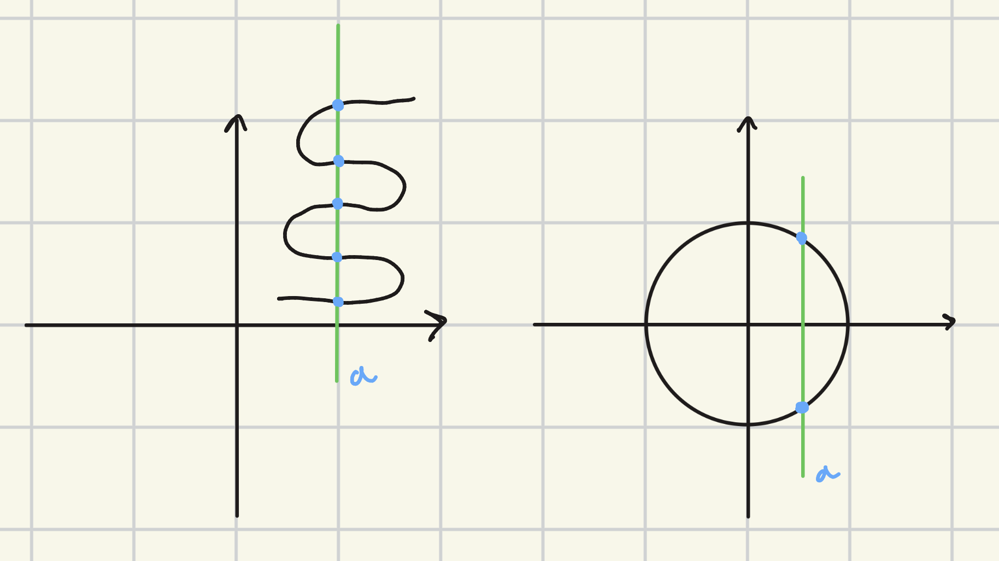
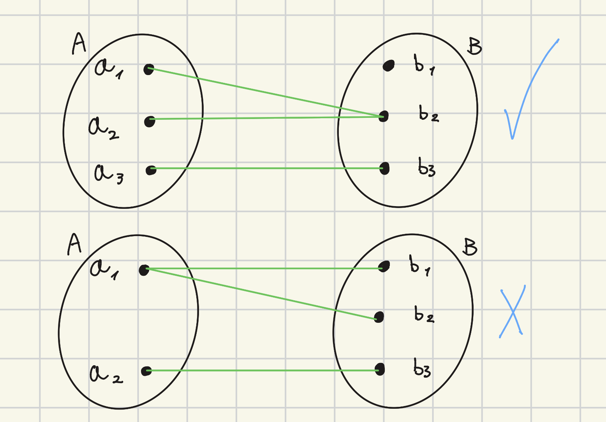
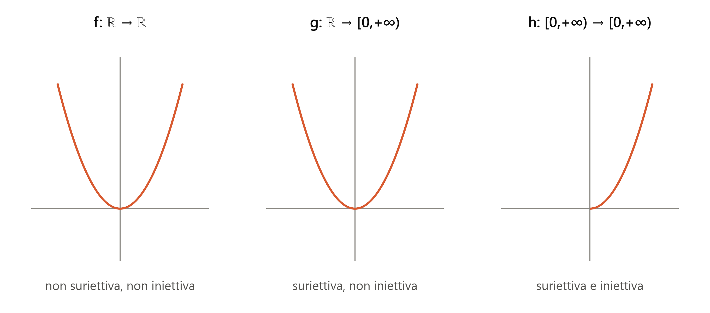
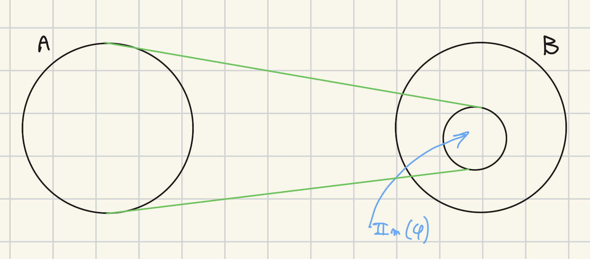
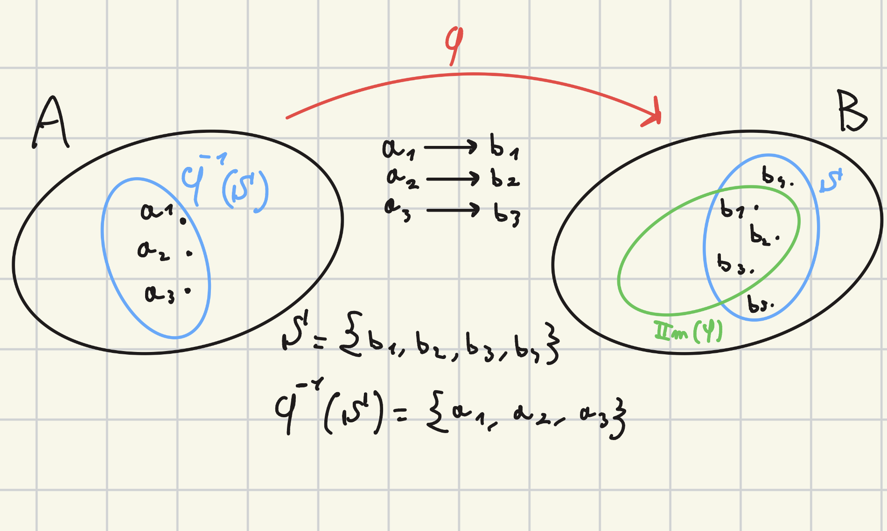
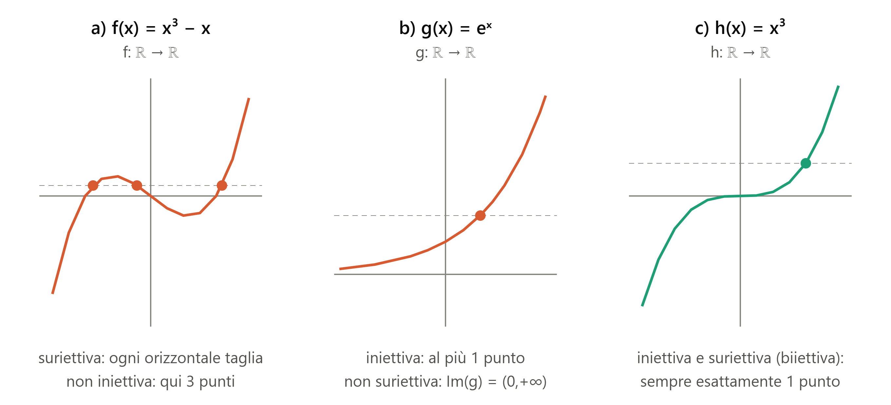

Data: 2026-10-13
[Analisi_1](./README.md)
#Puzzle_Of_Knowledge/Math/Analisi_1
___
# Index
___
# Definizione Insiemistica

> [!Abstract] Definizione: Insiemistica Di Applicazione
> Siano $A$, $B$ Insiemi.
> $$A \times B = {(a,b) : a \in A,\ b \in B}$$
> Diciamo **applicazione** un sottoinsieme $\Phi \subseteq A \times B$ tale che:
> $$\forall (a_1, b_1), (a_2, b_2) \in \Phi \text{ si ha che: se } a_1 = a_2 \implies b_1 = b_2$$
> 
>>[!info] Info: 
>>Perché sia un'applicazione da $A$ in $B$, ogni $a \in A$ deve comparire in qualche coppia di $\Phi$
>> 

> [!Info] Info: Esempi di Non Applicazioni
> Questi due esempi non sono applicazioni:

___

# Definizione Operativa

> [!Abstract] Definizione: Operativa Di Applicazione
> Siano $A, B$ insiemi.
> Diciamo **applicazione** una legge che associa ad ogni elemento di $A$ **un unico** elemento di $B$.
> > [!Info] Info:
> > 

## Notazione

> [!Abstract] Definizione: Notazione Di Applicazione
> 
$$\varphi : A \to B \qquad \text{"φ da A in B"}$$
> $$a \longmapsto \varphi(a) \in B \qquad \text{"a mappato in φ di a"}$$
> 
> - $A = D(\varphi)$ : **dominio** di $\varphi$
> - $B = C(\varphi)$ : **codominio** di $\varphi$
> 
>>[!Example] Esempio: 
>>
>>$$f: \mathbb{R} \to \mathbb{R},\quad x \mapsto x^2$$
>>$$g: \mathbb{R} \to [0,+\infty) = {x \in \mathbb{R} : x \ge 0},\quad x \mapsto x^2$$
>>$$h: [0,+\infty) \to [0,+\infty),\quad x \mapsto x^2$$
>>
>>
>>Sono tre applicazioni **diverse** (stessa legge, ma dominio/codominio diversi).
>>
>>|Applicazione|Dominio|Codominio|
> |---|---|---|
> |$f: \mathbb{R} \to \mathbb{R}$|$\mathbb{R}$|$\mathbb{R}$|
> |$g: \mathbb{R} \to [0,+\infty)$|$\mathbb{R}$|$[0,+\infty)$|
> |$h: [0,+\infty) \to [0,+\infty)$|$[0,+\infty)$|$[0,+\infty)$|
> >

## Insieme Immagine

> [!Abstract] Definizione: Insieme Immagine
> $$\mathrm{Im}(\varphi) := \left\{ b \in B \mid \exists a \in A \text{ per cui } \varphi(a) = b \right\} \subseteq B = C(\varphi)$$
> > [!Info] Info: 
> > - **Dominio** = tutto l’insieme $A$, cioè tutti i valori che si possono mettere in input.
> > - **Codominio** = tutto l’insieme $B$, cioè tutti i valori in cui si potrebbe arrivare.
> > - **Insieme immagine** = i valori di $B$ che vengono davvero raggiunti da qualche elemento di $A$
> > >   
> 
> > [!Example] Esempio: $f$ $g$ $h$
> > | Applicazione                     | Insieme immagine               |
> | -------------------------------- | ------------------------------ |
> | $f: \mathbb{R} \to \mathbb{R}$   | $\mathrm{Im}(f) = [0,+\infty)$ |
> | $g: \mathbb{R} \to [0,+\infty)$  | $\mathrm{Im}(g) = [0,+\infty)$ |
> | $h: [0,+\infty) \to [0,+\infty)$ | $\mathrm{Im}(h) = [0,+\infty)$ |
> 
> > [!Info] Info:
> > In generale $\mathrm{Im}(\varphi)$ è un sottoinsieme (anche proprio) del codominio $B$.
> > 
>
> > [!Abstract] Definizione: Altro Modo Per Rappresentare L'Insieme Immagine
> >$$\mathrm{Im}(\varphi) = \varphi(A)$$

## Controimmagine

> [!Abstract] Definizione: Controimmagine
> Sia $S \subseteq B$.
> Definiamo la **controimmagine** di $S$ secondo $\varphi$ l'insieme:
> $$\varphi^{-1}(S) := \left\{a \in A \mid \varphi(a) \in S \right\} \subseteq A$$
> 
> > [!Danger] Attenzione:
> > $\varphi^{-1}$ qui è un'operazione sui **sottoinsiemi** e non vuol dire "Funzione Inversa"
> 
> > [!Example] Esempio:
> > 
> 
> > [!Example] Esempio:
> > $f: \mathbb{R} \to \mathbb{R}$, $x \mapsto x^2$, $S = \left\{-1 \right\}$: $$f^\left\{-1\right\}(S) = \left\{x \in \mathbb{R} \mid x^2 = -1\right\} = \emptyset$$
> > $\ell: \mathbb{C} \to \mathbb{R}$, $x \mapsto x^2$, $S = \left\{-1\right\}$: $$\ell^{-1}(S) = \left\{x \in \mathbb{C} \mid x^2 = -1 \right\} = \left\{i, -i \right\}$$
> 
> > [!Info] Info: Controimmagine Lavora Sull'Insieme Delle Parti
> > Un’applicazione $\varphi: A \to B$ prende **un elemento** $a \in A$ e restituisce **un elemento** $\varphi(a) \in B$. 
> > La controimmagine invece prende **un insieme** $S \subseteq B$ e restituisce **un insieme** $\varphi^{-1}(S) \subseteq A$. 
> > Il suo input non è un elemento di $B$ ma un sottoinsieme di $B$, cioè un elemento di $\mathcal{P}(B)$. 
> > Il suo output è un sottoinsieme di $A$, cioè un elemento di $\mathcal{P}(A)$. Per questo si scrive $$\varphi^{-1}: \mathcal{P}(B) \to \mathcal{P}(A), \qquad S \longmapsto \varphi^{-1}(S)$$
> 
> > [!Info] Info:
> > $$\text{se } S \cap \varphi(A) = \emptyset \implies \varphi^{-1}(S) = \emptyset$$

___
# Suriettività e Iniettività

## Suriettiva

> [!Abstract] Definizione: Suriettiva
>  $\varphi: A \to B$ si dice **suriettiva** se e solo se: $$\mathrm{Im}(\varphi) = B$$

## Iniettiva

> [!Abstract] Definizione:
>  $\varphi: A \to B$ è detta **iniettiva** se e solo se:
>  $$\forall a_1, a_2 \in A,\ a_1 \neq a_2 \text{ si ha che } \varphi(a_1) \neq \varphi(a_2)$$

> [!Example] Esempio: Suriettiva e Iniettiva
> 

> [!example] Esempio: $f$, $g$, $h$ — suriettiva e iniettiva
>
> $$f: \mathbb{R} \to \mathbb{R}$, $x \mapsto x^2$$
> - **Non è suriettiva**: $\mathrm{Im}(f) = [0,+\infty) \ne \mathbb{R}$
> - **Non è iniettiva**: $1^2 = 1 = (-1)^2$, ma $1 \ne -1$
>___
> $$g: \mathbb{R} \to [0,+\infty)$, $x \mapsto x^2$$
> - **È suriettiva**: $\mathrm{Im}(g) = [0,+\infty)$
> - **Non è iniettiva**: $\forall \alpha > 0$, $g^{-1}(\{\alpha\}) = \{-\sqrt{\alpha},\ \sqrt{\alpha}\}$ ha due elementi
>___
> $$h: [0,+\infty) \to [0,+\infty)$, $x \mapsto x^2$$
> - **È suriettiva**: $\mathrm{Im}(h) = [0,+\infty)$
> - **È iniettiva**: $x^2 = \alpha$ con $\alpha \ge 0$ ha una sola soluzione in $[0,+\infty)$, quindi $h^{-1}(\{\alpha\}) = \{\sqrt{\alpha}\}$
> - Quindi $h$ è **biiettiva**
>___
> | Applicazione | Suriettiva | Iniettiva |
> | :--- | :---: | :---: |
> | $f: \mathbb{R} \to \mathbb{R}$ | ❌ | ❌ |
> | $g: \mathbb{R} \to [0,+\infty)$ | ✅ | ❌ |
> | $h: [0,+\infty) \to [0,+\infty)$ | ✅ | ✅ |

