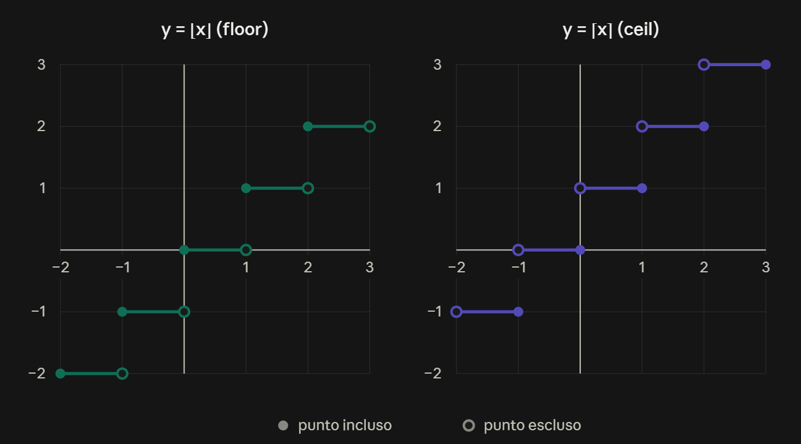
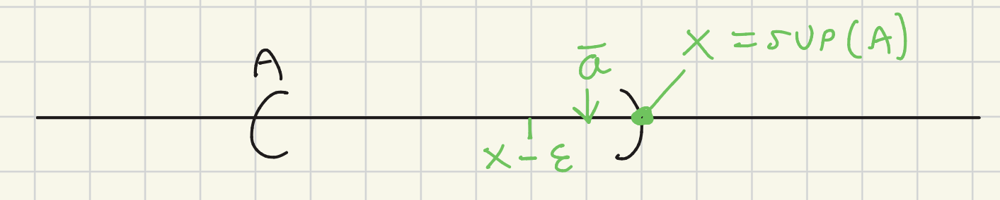
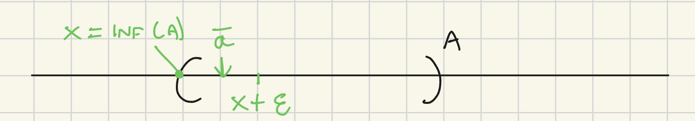

Data: 2026-09-30
[Analisi_1](./README.md)
#Puzzle_Of_Knowledge/Math/Analisi_1
___
# Index
- [[#Operazioni Insiemistiche]]
	- [[#Unione $\cup$|Unione ∪]]
	- [[#Intersezione $\cap$|Intersezione ∩]]
	- [[#Differenza $\setminus$|Differenza ∖]]
	- [[#Prodotto Cartesiano $\times$|Prodotto Cartesiano ×]]
- [[#Numeri Naturali $\mathbb{N}$|Numeri Naturali ℕ]]
	- [[#Operazioni]]
		- [[#Proprietà Delle Operazioni]]
			- [[#Addizione]]
			- [[#Prodotto]]
	- [[#Proprietà Dei Numeri Naturali]]
		- [[#Ordinamento Totale]]
		- [[#Compatibilità]]
- [[#Numeri Interi $\mathbb{Z}$|Numeri Interi ℤ]]
	- [[#Assioma Di Esistenza Dell'Opposto]]
- [[#Numeri Razionali $\mathbb{Q}$|Numeri Razionali ℚ]]
	- [[#Teorema L'equazione $x 2-2$ Non Ha Soluzioni Razionali|L'equazione x² − 2 = 0 non ha soluzioni razionali]]
	- [[#Inverso e Reciproco]]
	- [[#Assioma Dell'Inverso Moltiplicativo]]
- [[#Numeri Reali $\mathbb{R}$|Numeri Reali ℝ]]
	- [[#Assioma Di Separazione]]
	- [[#Proprietà Di Archimede]]
	- [[#Parte Intera]]
		- [[#Funzione floor $\lfloor x\rfloor$|Funzione floor ⌊x⌋]]
		- [[#Funzione ceil $\lceil x\rceil$|Funzione ceil ⌈x⌉]]
		- [[#Grafico a Gradini Funzione Floor e Funzione Ceil]]
	- [[#Proposizione $\sqrt{2} \in \mathbb{R} \setminus \mathbb{Q}$|Proposizione √2 ∈ ℝ ∖ ℚ]]
	- [[#Teorema Densità di $\mathbb{Q}$ in $\mathbb{R}$|Teorema Densità di ℚ in ℝ]]
- [[#Intervalli]]
	- [[#Proprietà Intervalli]]
		- [[#Maggioranti e Minoranti]]
		- [[#Superiormente Limitato e Inferiormente Limitato]]
		- [[#Massimo e Minimo]]
			- [[#Teorema]]
		- [[#Estremo Superiore e Estremo Inferiore]]
		- [[#Teorema Caratterizzazione Di $\sup()$ e $\inf()$|Teorema Caratterizzazione Di sup() e inf()]]
___

# Operazioni Insiemistiche

## Unione $\cup$

Elementi che stanno in **A oppure in B** (o in entrambi).

$$A \cup B = \{x : x \in A \lor x \in B\}$$

> [!example] Esempio: Operazione Di Unione
> $A = {1, 2, 3}, B = {3, 4} → A ∪ B = {1, 2, 3, 4}$
## Intersezione $\cap$

Elementi che stanno **sia in A sia in B**.

$$A \cap B = \{x : x \in A \land x \in B\}$$

> [!example] Esempio: Operazione Di Intersezione
> A = {1, 2, 3}, B = {3, 4} → A ∩ B = {3}

> [!info] Info: Insiemi Disgiunti
Se $A ∩ B = ∅$, i due insiemi si dicono **disgiunti**.
## Differenza $\setminus$

Elementi che stanno **in A ma non in B**.

$$A \setminus B = \{x : x \in A \land x \notin B\}$$
> [!example] Esempio: Operazione Di Differenza 
>$A = {1, 2, 3}, B = {3, 4} → A ∖ B = {1, 2}$

> [!danger] Attenzione! Non È Valida La Proprità Commutativa Sulla Differenza
> $A \setminus B \neq B \setminus A$

## Prodotto Cartesiano $\times$

Insieme delle **coppie ordinate** $(a,b)$ con il primo elemento preso da $A$ e il secondo da $B$.

$$A \times B = \{(a,b) : a \in A \land b \in B\}$$

> [!example] Esempio: Operazione Di Prodotto Cartesiano
> $A = \{1, 2\}$, $B = \{a, b\}$
> $$A \times B = \{(1,a),\ (1,b),\ (2,a),\ (2,b)\}$$

> [!danger] Attenzione! Non È Valida La Proprità Commutativa Sull Prodotto Cartesiano
> Il prodotto cartesiano **non è commutativo**:
> $$A \times B \neq B \times A$$
>
> > [!example] Esempio: 
> > Con $A = \{1, 2\}$ e $B = \{a, b\}$ si ha $(1,a)\in A\times B$, ma $(1,a)\notin B\times A$, perché in $B\times A$ il primo elemento deve stare in $B$.

___
# Numeri Naturali $\mathbb{N}$

> [!abstract] Definizione: Numeri Naturali
$$\mathbb{N} = \left\{0, 1, 2, 3, 4, \dots\right\}$$

## Operazioni

Su $\mathbb{N}$ sono definite due operazioni **addizione** e **prodotto**, e vanno interpretate come **mappe**
$$
+ : \mathbb{N}+\mathbb{N} \to \mathbb{N}, \quad (a,b) \mapsto a+b \qquad\qquad \cdot : \mathbb{N}\times\mathbb{N} \to \mathbb{N}, \quad (a,b) \mapsto ab
$$
### Proprietà Delle Operazioni
#### Addizione

$$Assioma: a,b,c \in \mathbb{N}$$

| Proprietà       | Formula                                                               |
| --------------- | --------------------------------------------------------------------- |
| Commutativa     | $a+b=b+a$                                                             |
| Associativa     | $(a+b)+c=a+(b+c)$                                                     |
| Elemento neutro | $\exists, e_0\in\mathbb{N}$ \| $a+e_0=a \quad \forall a\in\mathbb{N}$ |

> [!info] Info: Elemento Neutro Della Somma
> Il valore di $a$ non cambia grazie all'elemento neutro.
> Inoltre l'elemento neutro è **unico**:
> $$ \exists !, e_0 \in \mathbb{N} \quad\text{e}\quad e_0 = 0 $$

#### Prodotto
$$Assioma: a,b,c \in \mathbb{N}$$

| Proprietà       | Formula                                                                    |
| --------------- | -------------------------------------------------------------------------- |
| Commutativo     | $a\cdot b=b\cdot a \quad$                                                  |
| Associativo     | $(a\cdot b)\cdot c=a\cdot(b\cdot c)$                                       |
| Elemento neutro | $\exists, e_1\in\mathbb{N}$ \| $a\cdot e_1=a \quad \forall a\in\mathbb{N}$ |

> [!info] Info: Elemento Neutro Del Prodotto
> Il valore di $a$ non cambia grazie all'elemento neutro.
> Inoltre l'elemento neutro è **unico**:
>$$ \exists !, e_1 \in \mathbb{N} \quad\text{e}\quad e_1 = 1 $$

## Proprietà Dei Numeri Naturali

### Ordinamento Totale

> [!abstract] Definizione: Enunciato Ordinamento Totale Dei Numeri Naturali
> Per $a,b\in\mathbb{N}$ si **definisce**:
> 
> $$ a \le b \quad\Longleftrightarrow\quad \exists, c \in \mathbb{N} \ \mid\ a + c = b $$
> 
> Cioè $a\le b$ se esiste un naturale $c$ che sommato ad $a$ dà $b$

Questa relazione ha quattro proprietà:

|     | Proprietà          | Quantificatore                | Enunciato                                  |
| --- | ------------------ | ----------------------------- | ------------------------------------------ |
| a)  | **Riflessiva**     | $\forall a\in\mathbb{N}:$     | $a\le a$                                   |
| b)  | **Antisimmetrica** | $\forall a,b\in\mathbb{N}$:   | $a\le b$ e $b\le a$ $\Rightarrow$ $a=b$    |
| c)  | **Transitiva**     | $\forall a,b,c\in\mathbb{N}$: | $a\le b$ e $b\le c$ $\Rightarrow$ $a\le c$ |
| d)  | **Dicotomia**      | $\forall a,b\in\mathbb{N}$:   | $a\le b$ oppure $b\le a$                   |
### Compatibilità

**Compatibilità $(\le,+)$**:

$$ \forall a,b,c\in\mathbb{N}: \quad a\le b \Longrightarrow a+c \le b+c $$
**Compatibilità $(\le,\cdot)$**:

$$ \forall a,b,c\in\mathbb{N}: \quad a\le b \ \text{ e } \ c>0 ;\Longrightarrow; a\cdot c \le b\cdot c $$

> [!info] Info: Ordinamento Totale Dei Numeri Naturali Con Disuguagianza Stretta
> La stessa proprietà vale anche con la disuguaglianza stretta ($a<b$, $c>0 \Rightarrow ac<bc$).

___
# Numeri Interi $\mathbb{Z}$

> [!abstract] Definizione: Numeri Interi
>$$\mathbb{Z} = \mathbb{N} \cup (-\mathbb{N})$$
>Dove $$-A := {-a : a \in A}$$

## Assioma Di Esistenza Dell'Opposto

> [!Abstract] Definizione: Enunciato, Dell'Esistenza Dell'Opposto
$$\forall m \in \mathbb{Z}\ \ \exists, n \in \mathbb{Z} \mid m + n = 0$$

> [!info] Info: Compatibilità Con L'Ordinamento
> Se $a, b, c \in \mathbb{Z}$:
>- $a \leq b,\ c > 0 \Rightarrow ac \leq bc$
>- $a \leq b,\ c < 0 \Rightarrow ac \geq bc$ 

> [!danger] Attenzione! Problema Nei Numeri Interi
> $$a \in \mathbb{Z}, \exists b \in \mathbb{Z} \mid ab = 1  \space(?)$$
> In $\mathbb{Z}$ Vale solamente per $a \in {-1, 1}$
> 
> $$b := a^{-1}$$ 
> $$1^{-1} = 1 ; -1^{-1} = -1$$

___
# Numeri Razionali $\mathbb{Q}$

> [!abstract] Definizione: Rappresentazione Canonica Dei Numeri Razionali
> $${ m \cdot n^{-1} : m \in \mathbb{Z},\ n \in \mathbb{Z} \setminus {0},\ \text{M.C.D.}(m,n) = 1 }$$
> > [!Info] Info: 
>  $$\text{M.C.D.}(m,n) = 1 \space$$
>  $m, n$ si dicono coprimi tra loro
> 
> > [!Example] Esempio:
> $\frac{1}{3} \sim \frac{2}{6} \sim \frac{3}{9}$, si prende in considerazione solo $\frac{1}{3}$ dove $1$ e $3$ sono coprimi tra loro.
> 

## Teorema L'Equazione $x^2-2$ Non Ha Soluzioni Razionali

> [!Success] Dimostrazione: Teorema L'Equazione $x^2-2$ Non Ha Soluzioni Razionali
> [[Dimostrazioni#1) L' Equazione $x 2 - 2$ Non Ha Soluzioni Razionali|Dimostrazione]]

## Inverso e Reciproco

L'**inverso** di $m$ è il suo **reciproco** in $\mathbb{Q}$: $\dfrac{1}{m}$.

> [!Info] Info: Inverso e Reciproco
> Inverso e reciproco sono operazioni diverse.

## Assioma Dell'Inverso Moltiplicativo

> [!Abstract] Definizione: Enunciato, Assioma Dell'Inverso Moltiplicativo
> In $\mathbb{Q}$ vale$$\forall a \in \mathbb{Q} \setminus \left\{0\right\}\ \ \exists b \in \mathbb{Q} \mid ab = 1 \quad (b = a^{-1})$$

___
# Numeri Reali $\mathbb{R}$

$$\mathbb{N} \subseteq \mathbb{Z} \subseteq \mathbb{Q} \subseteq \mathbb{R}$$

## Assioma Di Separazione

> [!abstract] Definizione: Enunciato, Assioma Di Separazione
> Siano $A,B\subseteq\mathbb{R}$ con $A\neq\emptyset\neq B$.
> Si dicono **separati** se
> $$a\le b \quad \forall a\in A,\ \forall b\in B$$
> Se $A,B$ sono separati, allora:
> $$\exists\,x\in\mathbb{R} \mid a\le x\le b \quad \forall a\in A,\ \forall b\in B$$
> $x$ è detto **separatore** di $A$ e $B$.
>> [!info] Info:
>> - Si può dimostrare che esiste un insieme $\mathbb{R}$ che verifica tali assiomi.
>> - Altre costruzioni di $\mathbb{R}$ sono equivalenti a quella assiomatica che usiamo.

## Proprietà Di Archimede

> [!abstract] Definizione: Enunciato, Proprietà Di Archimede
> $$\forall x\in\mathbb{R}\ \ \exists\,n\in\mathbb{N} \mid n>x$$
> > [!info] Info: In parole
>> Dato un qualunque reale $x$, c'è sempre un naturale più grande. 
>>
>> Quindi di dice che l'insieme $\mathbb{N}$ **non è limitato superiormente** in $\mathbb{R}$.
>
> > [!Success] Dimostrazione
> > [[Dimostrazioni#2) Proprietà Di Archimede|Dimostrazione]]

## Parte Intera

> [!abstract] Definizione: Enunciato, Proprietà della parte intera
> $$\forall x\in\mathbb{R}\ \ \exists!\,n\in\mathbb{Z}\mid n\le x<n+1$$
> $n$ è detto **parte intera** di $x$.
>>[!Info] Info: 
>>La **parte intera** di un numero con la virgola ($x$) è il numero intero più grande che non supera quel numero.
>>>[!Example] Esempio:
>>>**Se il numero è positivo ($x = 3.14$)**: Si trova tra $3$ e $4$ ($3 \le 3.14 < 4$). L'intero che ti sei lasciato alle spalle è **$3$**.
> >>

### Funzione floor $\lfloor x\rfloor$
$$n = \lfloor x \rfloor \iff n \le x < n+1$$
> [!Info] Info: Funzione Floor
> Arrotonda sempre e comunque per **difetto** al numero intero immediatamente inferiore o uguale.
> > [!example] Esempio:
>>- $\lfloor x\rfloor=0 \quad \forall x\mid 0\le x<1$
>>- $\lfloor 0{,}5\rfloor=0 \qquad \lfloor 2{,}5\rfloor=2$
>> - $-1\le -0{,}5<0 \Rightarrow \lfloor -0{,}5\rfloor=-1$

> [!danger] Attenzione! Funzione Floor Con i Numeri Negativi
> Per i numeri negativi la parte intera **non** è "togliere la parte decimale": $\lfloor -0{,}5\rfloor=-1$, non $0$.

### Funzione ceil $\lceil x\rceil$

$$n = \lceil x \rceil \iff n-1\le x<n$$

> [!Info] Info: Funzione Ceil
> Arrotonda sempre e comunque per **eccesso** al numero intero immediatamente superiore o uguale
> > [!example] Esempio:
>>- $\lceil 0\rceil=0$
>> - $\lceil \tfrac{3}{2}\rceil=2$

> [!abstract] Definizione: Correlazione Con Floor e Ceil Con $\mathbb{N}$
> Per $x\in\mathbb{Z}$ vale $\lceil x\rceil=\lfloor x\rfloor=x$.
>
> > [!example] Esempio: $x=3$
> > $$\lceil 3\rceil=\lfloor 3\rfloor=3$$
>
> > [!danger] Attenzione!
> > $x\in\mathbb{Z}$
> > L'uguaglianza
> > $$\lceil x\rceil=\lfloor x\rfloor+1$$
> > è **falsa** $\forall\, x\in\mathbb{Z}$.
> >
> > > [!example] Esempio: $x\in\mathbb{Z}$
> > > Per $x\in\mathbb{Z}$ vale $\lceil x\rceil=\lfloor x\rfloor=x$.
> > > Con $x=3$:
> > > $$\lceil 3\rceil=3\qquad \lfloor 3\rfloor+1=3+1=4$$
> > > Poiché $3\neq 4$, l'uguaglianza **non vale**.
>
> > [!info] Info: 
> > $x\in\mathbb{R}\setminus\mathbb{Z}$
> > L'uguaglianza $\lceil x\rceil=\lfloor x\rfloor+1$ è vera solo se $x\in\mathbb{R}\setminus\mathbb{Z}$.
> >
> > > [!example] Esempio: $x\in\mathbb{R}\setminus\mathbb{Z}$
> > > Con $x=2{,}5$:
> > > $$\lceil 2{,}5\rceil=3\qquad \lfloor 2{,}5\rfloor+1=2+1=3$$
> > > L'uguaglianza **vale**.

### Grafico a Gradini Funzione Floor e Funzione Ceil

## Proposizione $\sqrt{2} \in \mathbb{R} \setminus \mathbb{Q}$

> [!Success] Dimostrazione: Idea Della Dimostrazione Della Proposizione $\sqrt{2} \in \mathbb{R} \setminus \mathbb{Q}$
> $$A = \left\{x \in \mathbb{R} \mid x^2 > 2\right\}$$
$$B = \left\{x \in \mathbb{R} \mid x^2 < 2\right\}$$
Si verifica che tra i 2 insiemi sono separati: $\exists \lambda \in \mathbb{R}$
$$b \leq \lambda \leq a \quad \forall a \in A,\ \forall b \in B$$
Perché fa vedere che $\lambda^2 = 2$.  $\blacksquare$

## Teorema Densità di $\mathbb{Q}$ in $\mathbb{R}$

> [!Abstract] Definizione: Enunciato, Teorema Densità di $\mathbb{Q}$ in $\mathbb{R}$
> $$\forall x \in \mathbb{R}\ \text{e}\ \forall \varepsilon > 0,\ \exists z \in \mathbb{Q} \mid z \leq x < z + \varepsilon$$
> > [!Info] Info: In parole
> >  Dato un qualsiasi reale $x$ e una tolleranza $\varepsilon$, esiste un razionale $z$ appena prima di $x$ (o uguale) che dista da $x$ meno di $\varepsilon$.
> 
> > [!Success] Dimostrazione:
> > [[Dimostrazioni#1) Teorema di Densità di $ mathbb{Q}$ in $ mathbb{R}$|Dimostrazione]]

> [!Abstract] Definizione: Enunciato, Densità dei razionali e degli $\mathbb{R} \setminus \mathbb{Q}$ in $\mathbb{R}$
> Se $a, b \in \mathbb{R}$, $a < b$, allora:
> 1. $\exists r \in \mathbb{Q} \ \mid\ a < r < b$
> 2. $\exists \alpha \in \mathbb{R} \setminus \mathbb{Q} \ \mid\ a < \alpha < b$
>   
> > [!Info] Info: In parole
> > Prendi due numeri reali diversi, $a < b$, per quanto vicini siano. Allora:
> > 1. **Tra loro c'è sempre almeno un numero razionale** $r$ (una frazione).
> > 2. **Tra loro c'è sempre almeno un numero irrazionale** $\alpha$ (come $\sqrt{2}$ o $\pi$).

___
# Intervalli

> [!Abstract] Definizione: Enunciato Intervalli e Proprietà
>  $A \subseteq \mathbb{R}$, $A \ne \emptyset$ 
>  Si dice **intervallo** se e solo se: $$\forall x_1, x_2 \in A \mid \ x_1 < x_2$$ si ha che: 
>  $$\left\{x \in \mathbb{R} \mid x_1 < x < x_2\right\} \subset A$$
> > [!Example] Esempio: $A = (0,1) \cup \{2\}$ non è un intervallo
> >Qui $A$ è formato da un tratto, $(0,1)$, e da un punto isolato, $2$. Tra $1$ e $2$ c'è un "buco".
> > **Verifica**:
> > 1. Scelgo due punti di $A$: $x_1 = \tfrac{1}{2} \in (0,1)$ e $x_2 = 2$, con $x_1 < x_2$.
> > 2. Se $A$ fosse un intervallo, dovrebbe contenere tutto $\left(\tfrac{1}{2}, 2\right)$.
> > 3. Ma $\tfrac{3}{2} \in \left(\tfrac{1}{2}, 2\right)$ e $\tfrac{3}{2} \notin A$.
> > 4. Quindi $\left(\tfrac{1}{2}, 2\right) \not\subset A$, e $A$ **non è un intervallo**.

$$(a,b) = {x \in \mathbb{R} \mid a < x < b}$$ $$[a,b) = {x \in \mathbb{R} \mid a \le x < b}$$ $$(a,b] = {x \in \mathbb{R} \mid a < x \le b}$$
## Proprietà Intervalli

### Maggioranti e Minoranti

> [!Abstract] Definizine: Maggioranti e Minoranti
> $A \subseteq \mathbb{R}$, $A \ne \emptyset$
> 1. Diremo che $x \in \mathbb{R}$ è **maggiorante** di $A$ $\Leftrightarrow$ $a \le x\ \ \forall a \in A$.
> 2. Diremo che $x \in \mathbb{R}$ è **minorante** di $A$ $\Leftrightarrow$ $a \ge x\ \ \forall a \in A$.

### Superiormente Limitato e Inferiormente Limitato

> [!Abstract] Definizine: Superiormente Limitato e Inferiormente Limitato
> $A \subseteq \mathbb{R}$, $A \ne \emptyset$
> 1. Diremo che $A$ è **superiormente limitato** $\Leftrightarrow$ esistono **maggioranti** di $A$. 
> 2. Diremo che $A$ è **inferiormente limitato** $\Leftrightarrow$ esistono **minoranti** di $A$.
> 3. Diciamo $A$ **limitato** se e solo se $A$ è **sia** inferiormente che superiormente limitato.

> [!Abstract] Definizione: Sotto Insieme Di Insiemi Superiormente Limitati
> $A \subseteq \mathbb{R}$, $A \ne \emptyset$
> Sia $A$ **superiormente** limitato. Allora $B \subseteq A$ è **superiormente** limitato.
> > [!Success] Dimostrazione:
> > $A$ superiormente limitato $\Rightarrow \exists x \in \mathbb{R} \mid a \le x\ \ \forall a \in A$
> >
> > Poiché $B \subseteq A$, ogni $b \in B$ appartiene ad $A$, quindi:
> > $\Rightarrow b \le x\ \ \forall b \in B \subseteq A$
> > $\Rightarrow x$ è maggiorante di $B$
> > $\Rightarrow B$ è superiormente limitato.   $\blacksquare$

> [!Abstract] Definizione: Sotto Insieme Di Insiemi Inferiormente Limitati
> $A \subseteq \mathbb{R}$, $A \ne \emptyset$
> Sia $A$ **inferiormente** limitato. Allora $B \subseteq A$ è **inferiormente** limitato.
> > [!Success] Dimostrazione:
> > $A$ Inferiormente limitato $\Rightarrow \exists x \in \mathbb{R} \mid x \le a\ \ \forall a \in A$
> >
> > Poiché $B \subseteq A$, ogni $b \in B$ appartiene ad $A$, quindi:
> > $\Rightarrow x \le b\ \ \forall b \in B \subseteq A$
> > $\Rightarrow x$ è minorante di $B$
> > $\Rightarrow B$ è inferiormente limitato.  $\blacksquare$

> [!Example] Esempio: Casi Insiemi Numerici
> #### $\mathbb{N}$
> - **Inferiormente limitato**? Sì.
> 
> > [!Success] Dimostrazione:
> >   $0 \le n\ \ \forall n \in \mathbb{N}$ $\Rightarrow$ $0$ è minorante $\Rightarrow$ $\mathbb{N}$ è inferiormente limitato.
> 
> - **Superiormente limitato**? No.
> 
> > [!success] Dimostrazione:
> >   Se fosse vero, $\mathbb{N}$ ammetterebbe maggioranti $\Rightarrow \exists x \in \mathbb{R} \mid n \le x\ \ \forall n \in \mathbb{N}$, violerebbe il principio di Archimede.
> 
> #### $\mathbb{Z}$
> - **Superiormente limitato**? No.
> 
> > [!Success] Dimostrazione:
> >   Se $\mathbb{Z}$ fosse superiormente limitato, anche $\mathbb{N} \subseteq \mathbb{Z}$ lo sarebbe (assurdo).
> 
> - **Inferiormente limitato**? No.
> 
> > [!Success] Dimostrazione:
> > [[Dimostrazioni#3) $ mathbb{Z}$ Non È Inferiormente Limitato|Dimostrazione]]
> 
> #### $\mathbb{Q}$
> - **Superiormente limitato**? No.
> - **Inferiormente limitato**? No.
> #### $\mathbb{R}$
> - **Superiormente limitato**? No.
> - **Inferiormente limitato**? No.

### Massimo e Minimo

> [!Abstract] Definizine: Massimo e Minimo
> $A \subseteq \mathbb{R}$, $A \ne \emptyset$
> 1. Diremo che $A$ **ammette massimo** se e solo se esiste $x_0 \in A \mid x_0 \ge a \space \forall a \in A$ $\Rightarrow$ $x_0$ è **maggiorante** nell'insieme.
> 
> 2. Diremo che $A$ **ammette minimo** se e solo se esiste $x_0 \in A \mid x_0 \le a \space \forall a \in A$  $\Rightarrow$ $x_0$ è **minorante** nell'insieme.
> 
> > [!danger] Attenzione: Differenze
> > Massimo/Minimo è un numero che fa parte dell'intervallo, **Maggiorante/Minorante** NO.
> >
> > > [!Info] Info:
> >> Se $\sup(A) \in A \Rightarrow \sup(A) = \max(A)$
> > >Se $\inf(A) \in A \Rightarrow \inf(A) = \min(A)$
> 
> > [!example] Esempio: $A = (0,1]$
> >
> > **Maggioranti e massimo**
> > 1. Insieme dei maggioranti:
> >    $$M_A = \{x \in \mathbb{R} \mid x \text{ maggiorante di } A\} = \{x \in \mathbb{R} \mid x \ge 1\}$$
> > 2. $1 \in M_A$ e $1 \in A$, quindi:
> >    $$1 = \max(A)$$
> >
> > **Minoranti e minimo**
> > 1. Insieme dei minoranti:
> >    $$m_A = \{x \in \mathbb{R} \mid x \text{ minorante di } A\} = \{x \in \mathbb{R} \mid x \le 0\}$$
> > 2. Nessun elemento di $m_A$ appartiene ad $A$, quindi:
> >    $$\nexists\, \min A$$
> >
> > **Massimo dei minoranti**
> > $$0 = \max(m_A)$$

#### Teorema

> [!Abstract] Definizione: Relazioni Tra Superiormente/Inferiormente Limitato Con Massimo/Minimo
> $A \subseteq \mathbb{R}$, $A \ne \emptyset$
> - Se $A$ è superiormente limitato $\Rightarrow M_A$ ammette minimo
> - Se $A$ è inferiormente limitato $\Rightarrow m_A$ ammette massimo
### Estremo Superiore e Estremo Inferiore

> [!Abstract] Definizione: Estremo Superiore e Estremo Inferiore
> > [!Info] Info:
> >$M_A =$ Insieme dei maggioranti di $A$ 
> >$m_A =$ Insieme dei minoranti di $A$
> 
> $A \subseteq \mathbb{R}$, $A \ne \emptyset$
> 1. Se $A$ è inferiormente limitato chiamiamo **estremo inferiore** di $A$: $$\inf(A) = \max(m_A)$$
> 2. Se $A$ è superiormente limitato chiamiamo **estremo superiore** di $A$: $$\sup(A) = \min(M_A)$$
> 3. Se $A$ non è inferiormente limitato scriviamo che:  
>    $$\inf(A) = -\infty$$
> 
>>[!Danger] Attenzione:
>> $-\infty \notin A$
>
> 4. Se $A$ non è superiormente limitato scriviamo che:
>    $$\sup(A) = +\infty$$ 
>
> > [!Danger] Attenzione:
> > $+\infty \notin A$
> 

### Teorema Caratterizzazione Di $\sup()$ e $\inf()$

> [!Abstract] Definizione: Enunciato, Caratterizzazione Di $\sup()$
> $A \subseteq \mathbb{R}$, $A \neq \emptyset$
> Se $A$ è superiormente limitato allora:
> $$
> x = \sup(A)\Leftrightarrow
> \begin{cases}
> x \ge a \quad \forall a \in A \\
> \forall \varepsilon > 0\ \ \exists\, \bar a \in A \mid \bar a > x - \varepsilon
> \end{cases}
> $$
> 
>> [!Success] Dimostrazione:
>> Contents

> [!Abstract] Definizione: Enunciato, Caratterizzazione Di $\inf()$
> $A \subseteq \mathbb{R}$, $A \neq \emptyset$
> Se $A$ è inferiormente limitato allora
> 
> $$
> x = \inf(A)\Leftrightarrow
> \begin{cases}
> x \le a \quad \forall a \in A \\
> \forall \varepsilon > 0\ \ \exists\, \bar a \in A \mid \bar a < x +\varepsilon
> \end{cases}
> $$
> 
>> [!Success] Dimostrazione:
>> Contents

___

